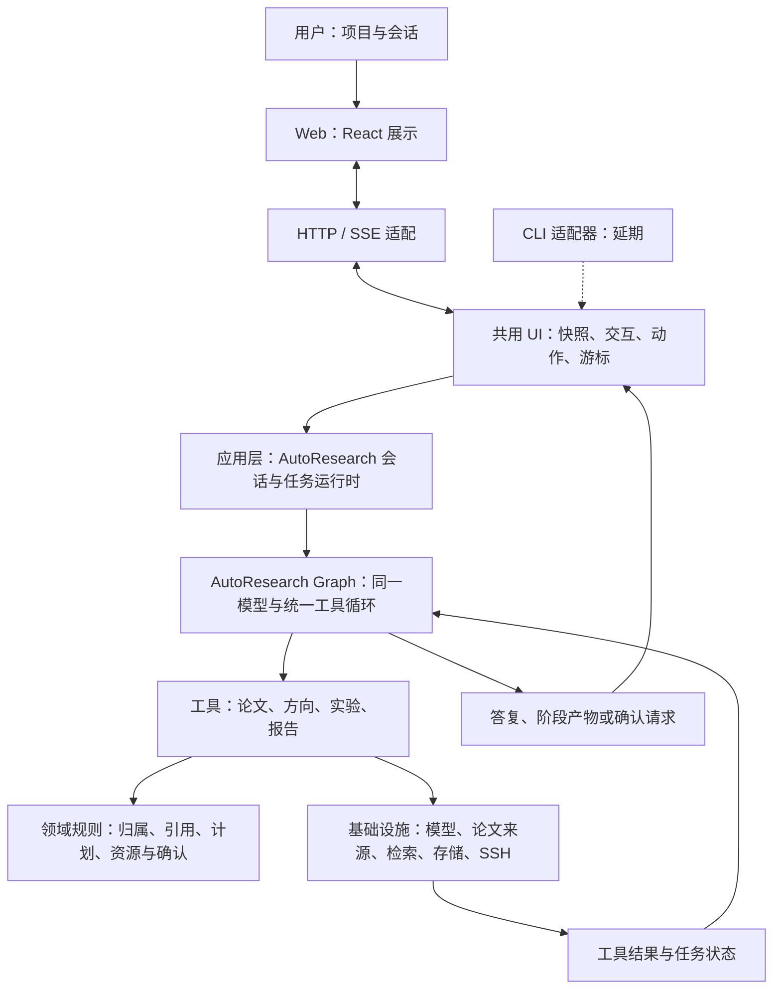
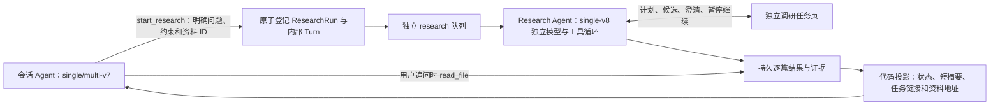

# AutoResearch：研究 Agent 产品架构

本文描述整体目标架构，能力随[阶段路线图](ROADMAP.md)逐步接入。当前单 Agent 与子 Agent 编排见 [Agent 双模式设计](phases/02-agent-runtime/AGENT_MODES.md)；远程实验等仍按后续阶段交付。

阶段 04 的工具边界已于 2026-10-25 精简：已有任务和报告复用文件读取，交互优先扩展 ask_user，研究成果暂通过 submit_research_result 提交；扩展同步参数、描述和执行方法，过于复杂时按职责拆分，不固定工具数量。[详细设计](phases/04-auto-research/DESIGN.md)中的方向、计划、候选与逐篇分析已实现；矩阵、Claim 和不可变报告版本已在 04-C1 交付；新独立研究使用 single-v8，普通会话使用 single/multi-v9，支持绑定报告版本并继续对话。

## 一、产品本身就是一个 Agent

AutoResearch 是基于 goHarness 实现的研究 Agent 产品。用户在项目会话中提出目标，Agent 读取项目上下文、规划下一步、选择工具、观察执行结果，再继续行动或向用户提问。

产品能力覆盖论文整理、方向探索、自动调研、论文复现和用户自己的实验。第一版提供统一的 Agent 入口，这些能力通过任务类型、工具和上下文组织。

例如，同一个会话可以连续提出：

> 帮我整理这个方向的论文。挑一篇适合复现的，检查实验室服务器能否运行。然后在现有代码上设计一组参数对比实验。

Agent 应当结合已有结果推进目标，执行到需要确认的计划时暂停，用户确认后继续。

## 二、整个 Agent 产品采用四层实现

| 层 | 负责什么 | 主要内容 |
| --- | --- | --- |
| 交互层 | 用户怎样与 Agent 协作 | 共用 `internal/ui` 协议与服务、React 工作区、HTTP/SSE；CLI 适配器延期 |
| 应用层 | Agent 怎样理解和推进任务 | 会话上下文、研究主图定义、工具注册、确认处理、后台任务协调 |
| 领域层 | 项目中的事实和规则是什么 | 项目、论文、证据、方向、研究任务、实验计划、实验记录，以及必要的存储和执行接口 |
| 基础设施层 | 工具怎样访问真实资源 | 模型接口、论文数据源、检索、持久化、SSH Connector、实验任务和产物存储 |

分层描述的是一个 Agent 产品内部的职责。Agent 的执行循环由应用层装配，领域层约束可执行动作，基础设施提供实际能力。

交互层内部也分清职责：`internal/ui` 依赖应用服务，将会话/研究目标转换成统一的快照、结构化用户交互、可用动作与事件游标；`internal/transport/httpapi` 处理 HTTP/SSE；React 负责可编辑选项、审核表单与 Markdown 渲染。未来 CLI 可以直接调用同一 UI 服务并用终端展示，或通过相同 HTTP 协议连接服务端。当前不实现 CLI 命令。

UI 不持有第二套运行状态，也不决定模型业务路线。模型继续调用 `ask_user`，Graph 保存真实中断；UI 映射成澄清、计划审核、候选审核或暂停，回答携带原 InterruptID、Turn Revision 和幂等键，交给现有应用规则审核与恢复。未知或损坏的交互只显示提示，不转换为普通自由文本问题。完整边界见 [UI 实施记录](phases/04-auto-research/UI_IMPLEMENTATION.md)。

报告引用由消息输入选择、应用层校验，持久在 Turn.ContextJSON 中。共用快照返回当前引用和历史消息的版本标记；Web 只维护发送前的附件草稿，未来 CLI 可使用相同消息协议。正文、矩阵与引用从报告自己的只读快照按需读取，不共享研究 Agent 的执行上下文。详见 [报告对话](phases/04-auto-research/REPORT_CONVERSATION.md)。

下面是运行时协作关系：



这张图表达调用过程。代码依赖由接口约束：应用依赖领域对象和接口；基础设施实现这些接口；领域代码不导入 SSH、数据库或模型 SDK。入口负责创建适配器并注入应用。

## 三、Agent 内部怎么组织

| 部分 | 职责 | 对应实现 |
| --- | --- | --- |
| 指令与任务目标 | 明确研究范围、当前目标和完成条件 | 系统提示、任务配置 |
| 项目上下文 | 提供选中论文、研究方向、代码位置、数据位置和已有结果 | 上下文组装与项目存储 |
| 会话与任务状态 | 记录对话、执行中的任务和待确认动作 | Session、ResearchRun、ExperimentRun |
| 业务编排 | 模型选择动作，代码落实权限、恢复与完成门槛 | 应用用 `pkg/graph` 定义 `agent_model` 与 `agent_tools` 循环 |
| 工具集 | 提供可验证的读取、整理、检索和实验动作 | `pkg/tool` 与应用用例 |
| 执行与恢复 | 执行节点与分支，保存和恢复执行进度 | `pkg/graph` 编译图、应用 ResearchState/Codec、`pkg/state` |
| 交互与观测 | 推送消息和进度，记录耗时、错误及调用身份 | `pkg/stream`、现有 callback、`pkg/observe` |

默认 `single` 模式在应用层直接定义 Graph，复用 ChatModelNode、ToolsNode、callback 和检查点。同一模型自主选择论文、工作区、笔记和 `ask_user` 工具，所有工具结果回到同一轮消息上下文。普通答复直接使用该模型的输出，不再经过独立路由模型或答复改写模型。

可选 `multi` 模式复用主图，只增加 goHarness subagent 扩展已有的 `run_subagent`。主模型决定是否委派；子 Agent 使用独立聊天历史和同一模型配置，工具仍受项目作用域与用户确认约束。子执行器由扩展的默认 Agent 构造器创建，不修改框架。

当前主图为：读取上下文 → 模型 → 工具 → 同一模型；模型调用 `ask_user` 时暂停并恢复到原上下文，模型完成答复后经过完成检查并持久化。配置模式在任务接收时固定，每种模式有独立定义版本；已有 v3 任务继续按原图恢复。详细节点、缓存边界与验证步骤见 [双模式设计](phases/02-agent-runtime/AGENT_MODES.md)。原[业务图](phases/02-agent-runtime/GRAPH_DESIGN.md)保留作旧任务兼容说明。

项目改名、论文标签编辑等明确的用户操作，由应用用例直接处理。同一用例也可以被 Agent 工具调用，保证手动操作和 Agent 操作采用相同规则。

每个会话独立保存历史和任务状态，按项目归属加载上下文。达到目标、需要用户确认或达到调用预算时，Agent 结束当前执行段，保存结果或待处理问题。

### 会话与独立研究的边界（会话 v7 / 研究 v8）



执行容器复用现有 Graph/Turn，不复制来源聊天历史和项目笔记。Research Agent 与普通会话共用模型连接配置，但各自持有消息、检查点和预算；研究工具不提供递归启动、Shell、文件写入和项目笔记保存。普通会话和研究各有一个 worker，一条长研究不会占用聊天 worker；同类任务依次执行。内部研究会话不进入用户会话列表，也不接受普通消息。

TaskSummary 直接从已保存结果生成，最多 500 字正文，不增加一次模型汇总；下一轮会话最多附带 5 条摘要。详细过程和全文只在任务页或用户明确要求读取时加载。来源会话/Turn 是追踪字符串，删除它们不级联删除任务。启动操作身份与输入指纹分别保存，同操作重放返回原 Run，同身份改变输入返回冲突。

计划与候选审核继续走 `ask_user` 的真实图中断，审核动作、业务版本和工具配对结果沿用现有持久恢复。现有 v1–v6 不自动升级；旧研究仍可在原会话继续，新 UI 和 `start_research` 统一走独立任务。详见 [实施记录](phases/04-auto-research/INDEPENDENT_AGENT_IMPLEMENTATION.md)。

## 四、Agent 产品的三类主要任务

| 任务类型 | 用户目标 | Agent 使用的能力 | 产物 |
| --- | --- | --- | --- |
| `literature_research` | 找论文、理解方法、整理方向和综述 | 搜索、保存、分析、比较、证据检索 | 论文库、方向提案、证据表、研究报告 |
| `paper_reproduction` | 判断论文实验能否复现 | 阅读论文和仓库、环境检查、制定计划、提交任务、比较指标 | 复现计划、实验记录、指标比较 |
| `user_experiment` | 验证用户自己的研究想法 | 理解现有代码与数据、设计参数对比、运行和分析实验 | 实验规格、参数表、结果与建议 |

任务可以在同一项目和会话中衔接。例如，调研结果选出一篇论文；复现发现一个待验证假设；用户继续要求运行自己的实验。任务记录分别保存，Agent 沿用已有项目上下文。

### 例子：从想法到服务器实验

1. 用户提出“比较两个检索模型在我的数据集上的 Recall@10 和延迟”。
2. Agent 读取当前项目中的模型配置、代码位置、数据说明和服务器信息。
3. 信息不足时向用户提问；信息充分后生成实验规格与参数矩阵。
4. Agent 调用只读检查工具，核对数据路径和现有环境，再形成待执行计划。
5. 应用校验计划，并向用户展示命令、修改范围、资源与输出。
6. 用户确认具体计划版本后，Agent 调用提交工具，取得任务 ID。
7. 服务器任务由任务管理器持续运行；监控程序保存状态和日志游标。
8. Agent 根据任务状态收集指标、解释差异并保存结果，用户可以继续追问。

## 五、工具是 Agent 与资源的连接点

| 工具组 | 代表工具 | 实际访问资源 |
| --- | --- | --- |
| 论文与证据 | `search_papers`、`save_paper`、`read_paper`、`search_project_evidence`、`save_evidence` | 公开论文源、项目论文库、检索索引 |
| 研究成果与笔记 | `submit_research_result`、`save_project_note` | 方向提案、计划、逐篇分析、报告及项目笔记 |
| 实验计划 | 创建计划、修改计划、读取计划 | ExperimentPlan 与确认记录 |
| 实验执行 | `inspect_server`、`prepare_workspace`、`submit_experiment` | Runner 执行接口 |
| 实验跟踪 | `get_experiment_status`、`tail_experiment_logs`、`collect_experiment_artifacts` | 远程任务状态和产物 |
| 已有研究资料 | `list_directory`、`read_file`、`search_files` | 当前项目资料视图、已保存的任务和报告 |

工具从可信会话上下文取得项目与用户身份；应用和领域规则校验归属、引用和执行范围。实验确认绑定计划内容与版本，计划改变后需重新确认。

## 六、Runner 是执行接口

Runner 在领域/应用边界定义执行需求，SSH 与 Connector 等基础设施实现它。它是实际任务执行器，不承担 LLM 决策。

MVP 的连接过程：

```text
AutoResearch 调用实验工具
    → 应用校验项目、计划和资源
    → 用户电脑上的 Connector
    → SSH 客户端连接实验室服务器
    → 已有进程管理器或实验调度器执行任务
```

SSH Agent 为 SSH 客户端提供身份认证。服务器已有 SSH 服务即可接入，第一版不要求部署 AutoResearch 常驻 Runner。

长实验使用服务器既有 Slurm、tmux 或其他明确配置的任务管理方式，保存任务身份、退出码和日志路径。普通 SSH 会话退出不能被当作实验完成。

后续可增加控制服务直连 SSH 或服务器侧执行进程；它们实现相同接口。用户电脑离线时，本机 Connector 无法实时回传状态，重新连接后根据任务身份重新核对。

## 七、持久化与恢复的职责

- 项目存储保存论文、方向、会话消息、任务及产物元数据。
- goHarness 检查点保存 Agent 的执行状态和待回答问题。内存检查点用于离线测试，跨进程恢复需要持久实现。
- 实施基线使用本地 SQLite 保存项目、会话、任务、事件和完整框架检查点，大文件存入 data/artifacts；应用独立模块引用框架，避免将业务依赖放进框架核心。
- 远程任务台账单独保存计划版本、幂等键、提交记录、服务器、任务 ID 和日志游标。
- 浏览器断开不会自动取消已经提交的实验；取消由显式任务操作决定。
- 服务重启或 SSH 断线后，先核对已提交任务，再决定是否继续监控或重试。提交结果不明时不盲目重发。
- 消息增量和业务活动使用 `pkg/stream`；大段实验日志通过独立日志存储与游标读取，不反复塞入模型历史。

人工确认使用框架中断/恢复能力实现；前端展示业务状态“等待确认”，公共生命周期事件使用框架已有的 interrupted 语义。

## 八、建议的项目内部目录

全部内容仍在 `auto-research/` 一个项目根目录下。阶段 01 已实现入口、React 工作区、项目与会话应用用例、领域规则、HTTP 和 SQLite 适配；Agent、SSE、CLI 调研及其他基础设施按后续阶段增加：

```text
main.go                 入口与组件装配
web/                    React 项目工作区
internal/transport/     HTTP、SSE、CLI
internal/app/           会话运行时、研究主图与 State、工具与任务协调
internal/domain/        项目、论文、证据、实验对象与接口
internal/infra/         模型、论文源、检索、存储、SSH 适配器
data/autoresearch.db    已实现的本地项目与会话存储
data/artifacts/         后续阶段的研究与实验产物
```

开发阶段为：本地工作台 → Agent 会话 → 论文库与学术工具 → 自动调研 → 远程实验 → 本地交付。后续服务端化与桌面客户端分别设计，不作为本地版本前置依赖。桌面本地模式不依赖多人服务端。

阶段交付见[路线图](ROADMAP.md)，全局编号与需求映射见[实施任务总览](IMPLEMENTATION_TASKS.md)。Runner 等跨阶段接口在 [CONTRACTS.md](tasks/CONTRACTS.md) 中统一定义；阶段内部设计在各自文档中细化。应用内部类型是本项目候选契约，不能当作框架现有 API。

阶段 02 的会话运行细节见[独立设计](phases/02-agent-runtime/DESIGN.md)：每轮独立检查点，已完成轮的正式消息构成下一轮历史，后台 worker 与 SSE 解耦，笔记工具按稳定调用键防重。当前编排以 [Agent 双模式设计](phases/02-agent-runtime/AGENT_MODES.md)为准。


## 04-C1 报告所有权与版本

ResearchRun 拥有 WorkItem 和报告版本。EvidenceMatrix 由现有分析投影，内容哈希与执行次数、Token 分开；ReportClaim 只绑定当前 Run 的分析版本和原文证据。现有 `submit_research_result` 在 v8 扩展 report 参数，不增加模型工具或推理节点。Research Agent 自己完成综合，会话只接收摘要和位置。

SQLite 013 保存不可变报告元数据、矩阵/证据快照及 OperationID 请求指纹；Markdown 复用 Artifact Store。提交、版本、Run 最新引用及 research.report 事件同事务登记。事务回滚可能遗留无引用内容文件，不会留下成功记录；未增加自动垃圾回收。只读 HTTP 与 research:// 按项目身份读取，正文由前端按报告 ID 加载，常规轮询不重复下载全文。旧 v1–v7 保留原工具 schema 和恢复/结束条件。
