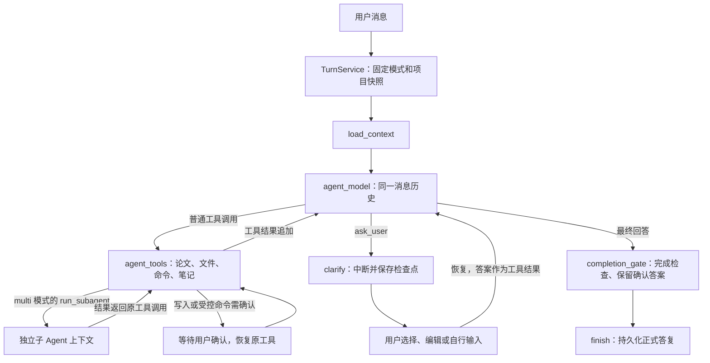

# Agent 双模式：设计、实现与验证

日期：2026-10-24。范围：AutoResearch 应用，不修改 goHarness 框架。

## 模式与职责

| 模式 | 模型如何工作 | 上下文 |
| --- | --- | --- |
| `single`（默认） | 一个模型节点自主选择全部研究工具并直接答复 | 同一轮完整保留模型消息、工具调用和结果 |
| `multi` | 同一主 Agent 按需调用 `run_subagent` | 子 Agent 独立历史；主 Agent 接收任务结果后综合 |

论文检索、代码检查、笔记保存可以组合在同一轮完成，不再分别经过理解目标、业务起草、答复改写等模型。业务判断交给模型；图上的条件边只检查已返回的工具调用、待澄清状态或完成状态。

| 组件 | 拥有的数据与责任 |
| --- | --- |
| `TurnService` | 固定本轮模式与定义版本；接收消息、排队、恢复、保存正式答复与 SSE 事件 |
| `ResearchState.Agent` | 本轮消息、模型轮次、工具调用次数、完成标记；进入 Graph 检查点 |
| `agent_model` | 使用稳定指令、项目资料、历史消息和当前问题；工具结果追加后继续使用同一模型 |
| `agent_tools` | 执行模型选定的已注册工具；校验调用批次、作用域、写入和命令确认 |
| `clarify` | 执行模型发起的 `ask_user`，通过 `graph.Interrupt` 等待回答 |
| subagent 扩展 | 使用框架已有的 `run_subagent` 和嵌套检查点；子 Agent 默认沿用主模型配置 |

主图由应用直接使用 Graph API 实现。子 Agent 使用 goHarness subagent 扩展的默认 Agent 构造器。数据库连接、模型实例和凭据由入口注入，不进入 State。

## 主图与数据流



每次执行使用 `agent_model` 同一个节点与同一组工具定义。主 Agent 决定是否需要澄清、调用哪个工具、是否委派以及何时完成。`ask_user`、写入、补丁、命令、笔记保存与子 Agent 委派必须各自独占调用批次。只读调用不再限制为单批四个，工具节点按顺序执行（`MaxConcurrency=1`）；总量继续受当前会话或调研任务的工具调用预算约束，增加批次大小不会提高并发。

业务可见的进度和工具摘要使用现有 SSE。`agent_model` 的正文块按增量投影为 `assistant.delta`；推理块、工具参数和系统提示不作为聊天正文发布。最终答复不会再被另一个模型重写。

## 工具与隔离

| 类型 | 工具 |
| --- | --- |
| 论文 | `search_papers`、`save_paper`、`list_papers`、`read_paper` |
| 文件与代码 | `list_directory`、`read_file`、`search_files`、`git_diff` |
| 执行与修改 | `run_shell`、`write_file`、`apply_patch` |
| 笔记与交互 | `save_project_note`、`ask_user` |
| 仅 `multi` 注册 | `run_subagent` |

论文作用域来自可信的图依赖，模型不能指定用户或项目。工作区工具沿用现有路径、命令和写入确认规则。保存笔记要求明确保存意图，内容不超过现有领域上限 4000 个字符；超限结果返回模型修正，按轮次工具键防重。

子 Agent 只接收明确的委派任务与指令，不自动继承主会话聊天历史、项目笔记或全部工具结果。需要的资料由主 Agent 写入任务，或者由子 Agent 使用获准工具读取。子 Agent 可以选择注册表内的工具子集，不能扩大项目权限、创建新工具或继续递归委派。其写入和追问中断经父图传播，恢复不重新生成原始任务。

当前只开放一次性同步 `run_subagent`，没有会话子 Agent 或并行调度界面。共享模型配置与项目资源不等于共享消息窗口。

## 缓存与恢复边界

模型输入顺序为：稳定系统指令 → 项目资料 → 原始会话历史 → 当前问题 → 本轮工具调用与结果。当前问题不再放在历史前方，追加消息不会改写已有对话前缀；工具定义在同一模式内保持稳定。

同一轮的完整工具上下文进入检查点，中断后继续追加。跨轮沿用已经提交的用户与助手消息，并补入已确认答案；跨轮不保留全部内部工具轨迹。因此可复用共同前缀，但不能承诺每轮完整缓存命中。项目资料、笔记、工具定义或模式发生变化会影响共同前缀；实际命中还取决于供应商的门槛、有效期与路由策略。子 Agent 的提示前缀独立计算。

本轮模式保存在 `turnContext.agent_mode`，任务接收后修改配置只影响新轮次。定义版本分别为 `autoresearch-agent-single-v1`、`autoresearch-agent-multi-v1`；无模式字段且使用 `autoresearch-phase3-graph-v3` 的已有任务继续进入原图。不能识别的版本明确拒绝恢复，不静默改换图。

主 Agent 每次执行最多 16 次模型调用、32 次工具调用，整体超时 5 分钟。每个子任务最多 8 次模型调用、2 分钟。它们是执行上限，并非跨父子 Agent 共享的 Token 或费用预算。

## 配置与手动体验

在实际启动使用的 JSON 配置中设置以下字段并重启后端：

```json
"agent_mode": "single"
```

改为 `"multi"` 可设置服务默认模式。省略或留空默认 `single`。聊天输入框上方提供“单 Agent / 多 Agent”按钮，当前会话的选择保存在浏览器，刷新后保留。选择随下一次新消息的 `agent_mode` 提交，不修改其他会话的默认值，也不改变已经开始或等待恢复的任务。`GET /api/runtime/agent` 返回服务默认模式。启动位置为本项目根目录：

```powershell
go run . serve --config config.example.json
```

真实学术来源改用 `config.arxiv.example.json`；在前端模型设置中配置支持工具调用的真实模型。`fixture` 只演示固定离线流程，不能用来验收自主检索或委派。

1. 单 Agent：发送“检索 2 篇 time series forecasting 论文，给出摘要层面的区别，不要归档或保存笔记”，观察论文工具和逐段答复。
2. 追问：继续要求细化方案；如模型需要关键条件，应看到可编辑选项，回答后继续原任务。是否追问由模型决定。
3. 笔记：发送“把刚才确认的研究问题和下一步保存为项目笔记”，检查笔记面板；没有保存请求的普通问答不应自动保存。
4. 协作：点击输入框上方“多 Agent”，直接发送“请用 run_subagent 独立检索 2 篇相关论文，你收到结果后比较它们”。观察主模型委派并综合；简单任务允许主模型直接完成。切换无需重启。
5. 权限与恢复：让主 Agent 或子 Agent 创建一份工作区实验说明文件，确认前检查文件尚未写入；重启后回答原确认，再检查文件内容与最终答复。
6. 论文入库：检索结果以论文卡片显示，展开摘要后点击“加入论文库”。按钮变为“已加入论文库”，右侧参考资料同步更新；点击“查看论文”或右侧标题打开详情。此操作直接保存结构化检索结果，不再调用模型。主 Agent 和子 Agent 的检索结果都支持。

子图检查点保存在当前 Turn 的子命名空间，每个键有独立历史和版本；父子检查点不会覆盖，跨轮键和非法路径会被应用 SQLite 适配器拒绝。当前轮的业务进度与论文工具结果完整进入快照，最近 100 条的窗口只限制诊断事件，避免较长执行丢失检索卡片。

## 本次自动验证

使用脚本模型和临时 SQLite/工作区验证：统一工具循环、跨轮消息前缀、确认答案跨轮保存、可信项目论文归档、超长笔记修正、子 Agent 历史隔离、父子写入确认与重建图恢复、模式固定、旧版 SQLite 检查点重启恢复，以及正文增量与内部推理过滤。

```powershell
go test -count=1 ./...
go vet ./...
npm --prefix web test
npm --prefix web run build
```

本次自动测试不调用收费模型，也不重新验证真实 arXiv 网络；它不证明供应商的实际缓存命中率。
