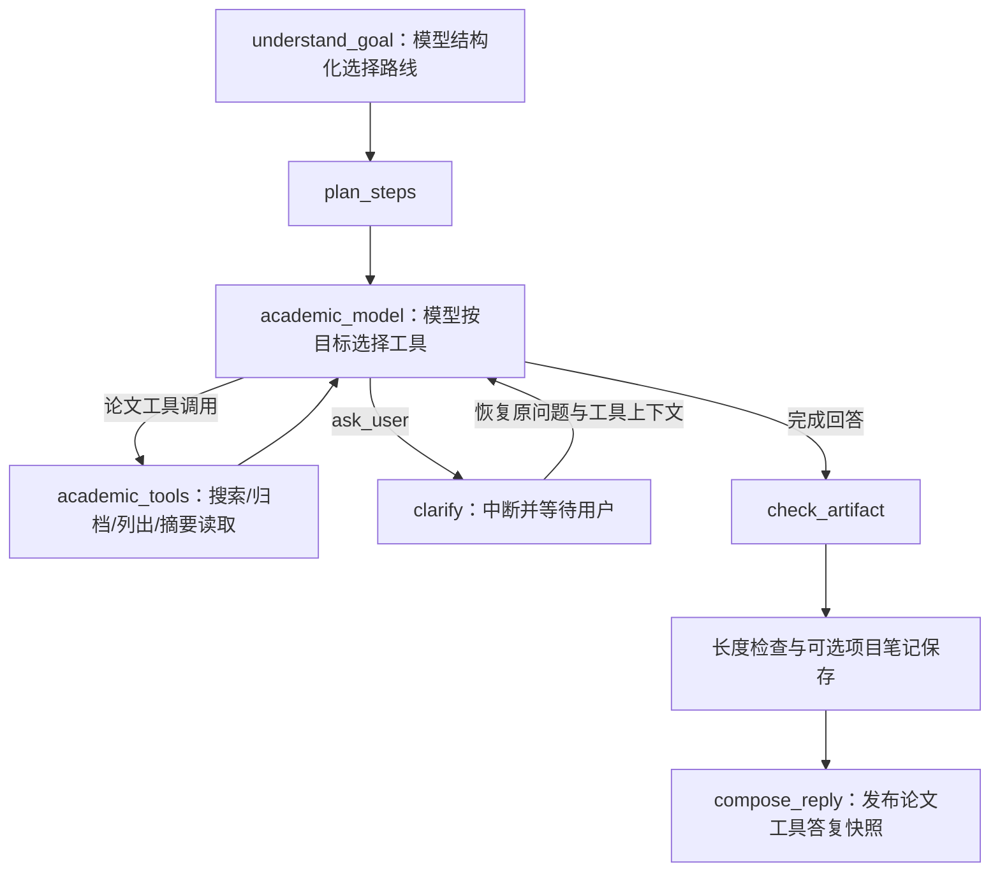

# 阶段 03 设计：论文库与学术工具

**状态：** 论文库基础闭环、真实 arXiv MCP 接入和 Graph 论文工具已实现；全文、Artifact Store、项目内检索和点击引用已按补齐计划实施，验证见 ACCEPTANCE.md。
**前置：** 阶段 02 Agent 会话 MVP 已完成。
**目标：** 让同一个 Agent 能搜索公开学术来源、将用户选择的论文归档到项目，并从已归档文本中提供可定位的证据。

## 1. 用户流程

用户在项目会话中提出“找几篇关于 X 的论文”时，Agent 通过学术来源工具搜索候选。候选只作为临时结果展示；用户或 Agent 明确调用保存动作后，论文才进入当前项目的论文库。论文库页面支持筛选、归档状态、标签、阅读状态和用户笔记。

用户打开论文详情时可以查看来源元数据、摘要和已归档文本。若来源只提供摘要，界面明确标记“仅摘要”，不把摘要描述成全文。后续阶段的调研 Agent 只从项目论文库和证据接口读取资料。

## 2. 边界与职责

阶段三新增论文与证据业务能力，仍然只有一个 AutoResearch Agent：

| 层 | 职责 |
| --- | --- |
| Graph/应用 | 将搜索、保存、读取和证据工具接入现有会话图；模型选择工具，应用校验项目归属和参数 |
| 领域 | 规范化论文身份、版本、来源级别、阅读状态、笔记和证据定位规则 |
| 基础设施 | 通过现有 MCP 扩展连接来源；SQLite 保存元数据；Artifact Store 保存冻结文本 |
| 前端 | 搜索结果、论文库、详情、笔记和引用跳转；不显示模型原始 JSON |

MCP 只是来源适配器。第三方工具不能直接写项目表，也不能决定项目 ID、归档策略或证据合法性。第一真实来源是 arXiv MCP；fixture 来源用于离线验收。Zotero、OAuth、MCP Resources/Prompts 不进入本阶段。

## 3. 领域对象

```go
type Paper struct {
    ID, ProjectID, SourceKey, Title string
    Authors []string
    Year int
    DOI, ArxivID, URL, Abstract string
    Tags []string
    Note, ReadingState string
    Revision int64
}

type Candidate struct {
    SourceKey, Title, URL, DOI, ArxivID string
    Authors []string
    Year int
    Abstract, Provider string
}

type SourceDocument struct {
    ID, PaperID, ArtifactID, Text, SHA256, Locator string
}

type Evidence struct {
    ID, ProjectID, PaperID, DocumentID string
    Field, Value, Quote, Locator string
    StartRune, EndRune int
}
```

`SourceKey` 是项目内去重键。DOI 统一为小写 `doi:<value>`；arXiv 统一为不带版本后缀的基础 ID，当前摘要文档以来源位置和文本 SHA-256 冻结；具体 arXiv 版本号尚未单独持久化，不能保证按指定历史版本抓取。原文以规范化换行后的 UTF-8 文本冻结并计算 SHA-256。证据使用 Unicode rune 半开区间，`Quote` 必须与文档区间逐字一致。

## 4. 来源接口与工具

应用依赖以下接口，fixture 和 MCP 来源都实现它：

```go
type PaperSource interface {
    Search(context.Context, PaperQuery) ([]Candidate, error)
    Resolve(context.Context, string) (Candidate, error)
    Read(context.Context, string, string) (SourceDocument, error)
}
```

应用工具固定提供：

- `search_papers`：只读，返回有界候选列表，不写入项目。
- `save_paper`：写入当前项目，按 `SourceKey` 幂等去重。
- `list_papers`：读取当前项目论文及用户笔记，获取可信本地 paper_id。
- `read_paper`：读取已归档论文摘要，归档冻结文本并返回文档 ID、SHA-256 和明确的摘要 Locator。
- `ask_user`：在缺失信息会改变行动时由模型主动调用，使用既有中断和恢复链路。

论文笔记修改目前通过 HTTP/PapersPage 的 revision 接口完成；尚未暴露 `get_paper`、`save_paper_note` 等扩展工具。

模型参数不接受 `user_id`、`project_id` 或任意服务器路径；Scope 从可信应用上下文注入。候选数量和 Graph 循环有上限，文本存入 SQLite；本阶段只返回摘要，尚未使用 Artifact ID 外置长全文。

## 5. MCP 连接

本轮通过 `academic.mode=arxiv_mcp` 和可配置的 `uvx` 命令启动固定版本 `arxiv-mcp-server==0.8.2`；源码适配器按其实际 schema 映射。启动时完成握手和 `tools/list`，缺少必需工具则启动失败，连接由服务统一关闭。默认 `fixture` 模式不建立外部连接。

使用现有 `extensions/mcp` 的 stdio 传输与 Strict Policy，只允许启动配置指定的命令，只开放上游 `search_papers`、`get_abstract`。远端工具保持私有：模型只能看到本地应用定义的四个论文工具，因此不需要通过名称前缀向模型暴露动态远端目录。

搜索映射 `query/max_results/date_from/date_to/abstract_mode=full`，元数据按 `get_abstract(paper_id)` 解析。`read_paper` 只支持摘要；不能将其描述为全文阅读。搜索返回的完整摘要保存在有界进程缓存中，后续归档和读取可以复用，减少重复请求。

每次调用有配置的 5–120 秒上限；同一来源串行请求，返回 `rate_limited` 时按上游建议冷却。连接错误、MCP isError、业务错误状态和无效 JSON 明确返回失败；无匹配的空列表正常返回。真实来源故障不回退到 fixture。

`GET /academic/status` 只报告已配置来源和读取范围，不将配置成功冒充实时健康检查。来源重连、MCP Resources/Prompts、全文下载和复杂动态目录留待后续扩展。

## 6. 持久化与 HTTP

阶段三新增迁移，不修改已发布迁移：`papers`、`paper_notes`、`source_documents`、`evidence`、`artifacts` 及必要索引。所有查询带 Scope；`UNIQUE(project_id, source_key)` 保证项目内幂等，跨项目保留独立论文和笔记。

HTTP 端点统一挂在项目作用域下：

```text
GET  /api/projects/{projectID}/papers
POST /api/projects/{projectID}/papers
GET  /api/projects/{projectID}/papers/{paperID}
PATCH /api/projects/{projectID}/papers/{paperID}
POST /api/projects/{projectID}/papers/{paperID}/notes
GET  /api/projects/{projectID}/papers/{paperID}/documents
GET  /api/projects/{projectID}/papers/{paperID}/evidence
GET  /api/projects/{projectID}/academic/status
POST /api/projects/{projectID}/academic/search
```

写入接口使用 revision；导入已存在论文返回已有对象而不是重复插入。来源暂时不可用与论文不存在分别映射为 503 和 404/422。

## 7. 证据规则

证据保存前必须验证：论文、文档和项目归属一致；区间非负且不越界；`Quote` 等于文档 rune 区间；文档哈希和版本匹配。只有摘要时 `Locator` 标记 `abstract`。模型没有找到原文支持的内容保存为 `inference` 或 `unverified`，不能作为论文事实。

检索范围由 Scope 派生，只查询当前项目已归档文本。TopK、片段长度和引用数量有上限。引用返回 PaperID、DocumentID、EvidenceID 和 Locator，前端通过应用路由打开冻结片段，不暴露服务器绝对路径。

## 8. 验收场景

1. fixture 来源搜索返回一条带 `arxiv:2401.00001` 的候选，候选不自动进入论文库。
2. 同一项目重复保存同一 DOI/arXiv ID 返回同一个 Paper ID；两个项目各自有独立笔记。
3. 论文详情能区分摘要和全文，来源 ID、版本、抓取时间可追溯。
4. 合法证据可保存并在冻结文本中定位；伪造 Quote、跨项目文档、越界区间被拒绝。
5. MCP 缺工具、超时或格式变化显示明确错误；不会伪造空论文列表。
6. 浏览器完成搜索、归档、筛选、编辑笔记、打开证据片段；刷新后数据仍在。


## 9. 本轮 Graph 接入



业务路线由模型选择，代码只校验合法工具、项目归属和预算。论文流程最多 8 次模型调用、24 次工具调用；每批工具按序执行。工具错误以可读内容交回模型，取消仍遵循图运行时的取消语义。`academic.tool` 和 `research.progress` 由现有公共流投影到前端，内部路由 JSON 不进入助手消息。

论文路线的最终答复直接取自 `academic_model` 完成工具循环后的助手消息，不再调用缺少工具上下文的通用整理模型，避免论文清单、引用和执行事实被二次改写。笔记压缩只影响保存的项目笔记，不截短最终论文答复；保存成功后附加明确提示。`compose_reply` 发布最终快照，本次不增加论文节点逐 Token 展示能力。

图定义与 StateCodec 升级到第三版。旧版未完成轮次使用原有 recovery_required 机制明确提示处理，不把旧检查点强行放入新图。已完成历史消息保留。快照额外保留本轮业务进度和工具结果，防止被最近 100 条诊断事件窗口挤掉。
