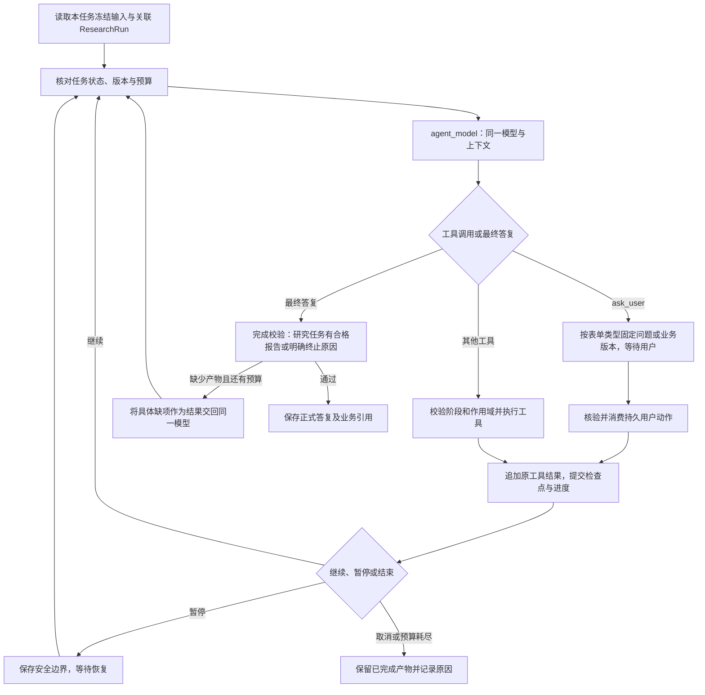
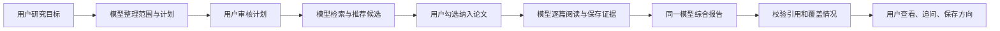
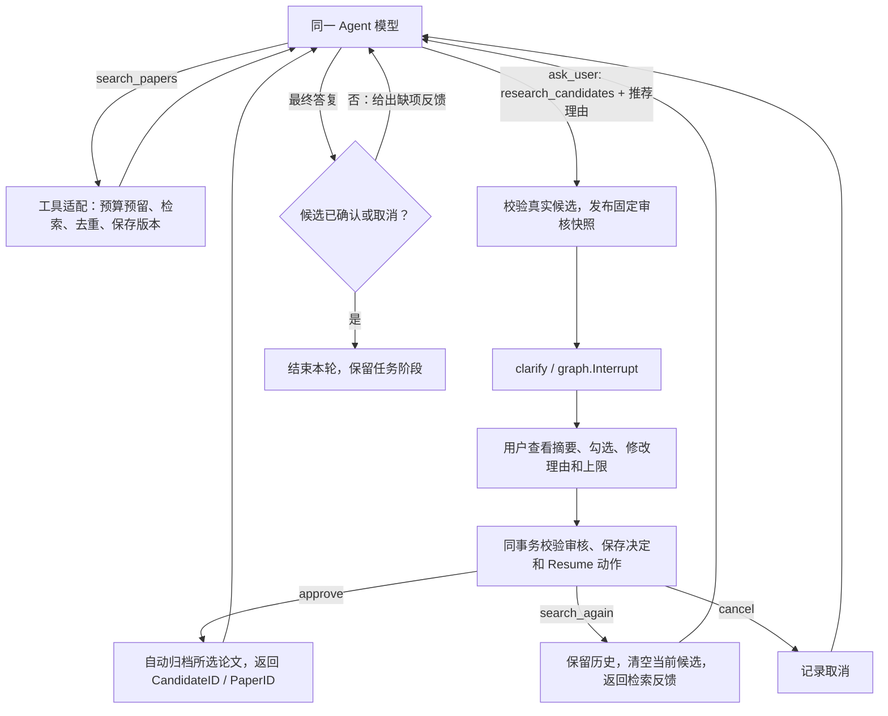
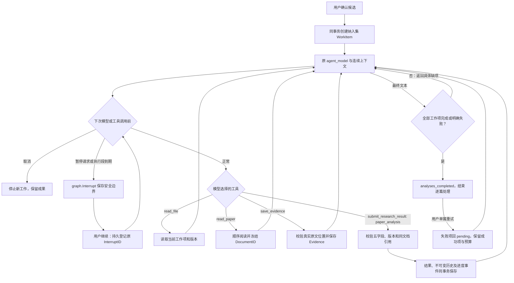
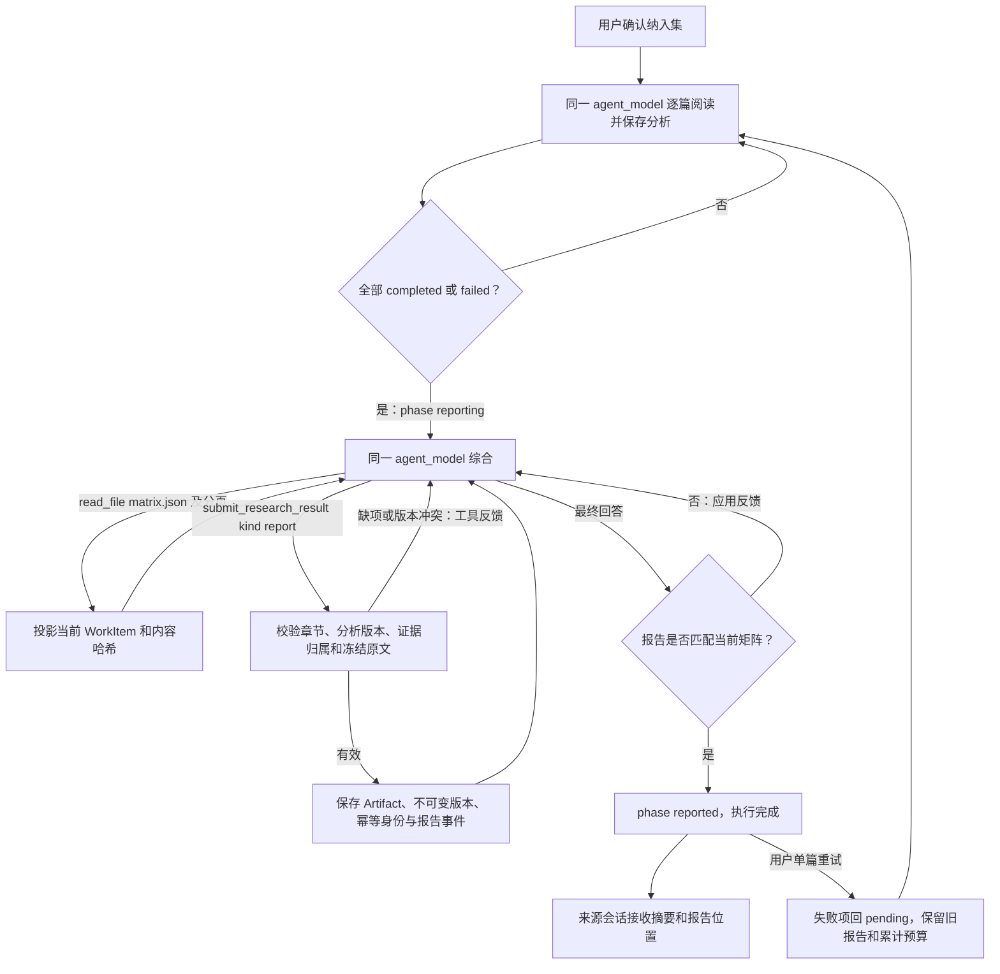

# 阶段 04 Graph：单 Agent 与可核验研究流程

日期：2026-10-25。当前普通会话 single/multi-v7，新独立研究 single-v8；04-C1 已接入证据矩阵、Claim、报告与原文引用。旧 v1–v7 的工具 schema 和恢复/结束条件保留。各批历史分支见下文，最新报告流程见文末。

## 1. 图的职责

在每个执行容器内保留同一个 `agent_model` 和连续消息上下文。会话通过 `start_research` 委派到独立 ResearchRun，研究图从显式输入开始；研究内部规划、检索与阅读共享自己的连续上下文。规划、阅读和综合是同一 Agent 在不同任务阶段选择的动作，不分别创建 planner / reader / writer 模型节点。Graph 的分支落实模型已返回的工具选择，以及已登记的中断、阶段和预算状态。



上图为逻辑节点；实现复用当前 `load_context`、`agent_model`、`agent_tools`、`clarify` 和完成节点。交互统一通过 ask_user；读取复用文件工具，正式成果统一提交；不为每张表增加模型工具或图节点。

## 2. 业务流程和用户参与点



这是任务的完成条件顺序，不是代码根据关键词猜意图。普通问答不强制进入该流程；缺少具体信息是否追问由模型决定。正式调研必须确认计划和纳入集，应用阻止越过审核，避免模型口头表示“已确认”就执行。

| 当前阶段 | 可推进的业务动作 | 拒绝的动作及原因 |
| --- | --- | --- |
| planning | 登记/编辑计划、澄清、请求计划审核 | 批量论文分析：研究范围未确认 |
| searching | 按确认计划检索、去重和登记候选、请求候选审核 | 报告提交：尚无已确认纳入集 |
| reviewing | 查看固定候选，消费用户审核；用户可要求调整计划 | 自动接受全部论文：不能伪造用户选择 |
| analyzing | 获取纳入论文正文、检索对应证据、逐篇保存 | 为排除论文登记本 Run 分析：违背用户纳入集 |
| reporting | 综合已有结果、提交带引用报告，按缺项返回补充分析 | 引用外部任务证据或未读内容：来源不满足要求 |
| done | 查看与追问，或创建新 Run | 覆写旧报告、修改原始研究快照 |

模型可发现资料不足并请求调整；改变范围创建新 Run，改变检索计划递增版本并重新审核。代码验证这些条件，不决定研究主题和建议结论。

## 3. 交互工具怎样落地

扩展现有 `ask_user`，kind 默认 clarification，保持可编辑选项和文本回答；新增 research_plan / research_candidates 表单类型，不新增模型工具名称。模型选择要请求的表单，业务对象从当前 Run 加载并校验 expected_revision，不能让模型在表单里重建一份候选或批准状态。三个类型都复用 `graph.Interrupt`；候选审核的中断 payload 为：

```json
{
  "kind": "research_candidates",
  "run_id": "run-id",
  "revision": 2,
  "hash": "fixed-candidate-snapshot-sha256",
  "analyze_limit": 4,
  "candidate_ids": ["candidate-1", "candidate-2"]
}
```

完整候选从任务 API 读取，前端展示复选框和摘要。提交包含选中 CandidateID、审核版本及幂等键；身份与 InterruptID 由可信服务端关联。HTTP review API 仍保留，在同一事务记录业务决定与 TurnAction，再恢复原 ask_user 调用，结果作为配对 tool result 追加给模型。普通追问返回文本，审核返回结构化决定；不把候选集合编码成自由文本再猜测解析。

交互工具必须独占调用批次，不能和文件写入、研究结果写入混合。确认后从原调用继续，恢复时不重新让模型生成问题或候选集。旧版本返回 409，前端加载当前待审核对象。

现有 3 次澄清上限只统计 clarification；计划/候选审核不占用这三个名额，但受 Run 的审核版本、模型/工具预算及取消规则约束。旧定义版本保留原参数和答案解码。

## 4. State、持久化与事件

Graph State 新增小型研究引用：RunID、SpecHash、Phase、计划/候选 Revision、当前 WorkItemID、待审核引用及执行预算。详细候选、正文、证据矩阵和报告正文通过 read_file 的项目资料视图按需读取，不塞满检查点。内部用例和前端继续直接通过应用 API 访问业务对象，不绕文件视图调用。

`submit_research_result` 按 direction / plan / paper_analysis / report 进入对应应用用例，校验后返回 ID、版本和可读地址。Run 首次关联、阶段转换和状态登记由用例自动完成，模型不再单独调用 create/update/get 任务工具。引用准确性仍由 EvidenceService / ReportService 保证，不能把写 Markdown 当作已完成报告提交。

该名称是当前候选入口。若参数或权限差异使合并过于复杂，可按成果职责拆成多个工具；同样复用上述 Graph 的工具执行分支与内部应用服务。扩展或拆分都必须同步参数 schema、描述、执行方法及返回结果，并固定到新的图定义版本。

工作结果先按稳定业务键提交，检查点随后提交；重放时检查已登记结果并返回相同身份。模型或外部请求在响应提交前崩溃仍可能重发，已有业务结果不重复新增。暂停、取消和恢复在同一 Run 内串行。

研究进度新增 `research.plan`、`research.candidates`、`research.paper`、`research.report` 业务事件，复用当前事件表、SSE 游标和快照流程。前端按 RunID / 对象ID / Revision 更新卡片，防止快照与增量造成重复展示；callback 继续提供模型用量、缓存 Token、耗时及错误。

新增工具和 State 字段需要新图定义与 Codec；旧版构造器/工具 schema 保留，按 Turn 的 DefinitionVersion 选择。新旧状态都通过重启恢复回归后才能启用，不能仅修改版本字符串就宣称兼容。

## 04-B 首批的实际分支（历史 v4）

single/multi-v4 在原 agent_model → agent_tools → agent_model 循环上增加 incomplete_research 回边。agent_model 收到最终文本时先检查已保存计划；缺少计划或用户确认，就追加应用缺项反馈并回到原模型。completion_gate 保留最终消息校验。普通会话没有 Run 时直接结束，不强制进入审核。

审核参数错误以配对 tool result 返回模型修正；合法 research_plan 调用固定已保存的版本/哈希/表单后进入 clarify，用 graph.Interrupt 等待用户。审核不计入原 clarification 三次额度。Resume 与用户修改/批准在业务事务中登记，恢复读取认可后的计划和版本，再返回 agent_model。

v4 工具参数是 direction/plan 两类成果、clarification/research_plan 两类交互。该历史版本未启用候选审核和报告；v5 候选能力见下节。预算适配仅在应用层包装调用预留，观测继续走原 callback，未改 goHarness。
## 04-B2 历史分支（v5，继续支持恢复）



这里的业务条件限制可执行范围，推荐内容和重检策略仍由模型选择。只扩展现有 agent_model / agent_tools / clarify 路径，没有增加规划、阅读或写作模型。审核不消耗三次普通澄清额度。

中断仅保存候选身份、版本和哈希引用，元数据由前端从任务详情加载；已发生的有界工具结果仍保留在原 Agent 消息中。审核拒绝旧表单与跨任务候选。审批、论文映射、动作登记失败会整体回滚；worker 重启从持久动作恢复结构化 tool result。v4 任务仍使用旧计划审核 schema，不强制补做 v5 候选审核。

## 04-B3 逐篇分析分支（v6，v7 继续复用）



上图将调用边界画在工具执行前；模型 prehandler 也检查相同边界。业务条件仍验证模型动作，阅读顺序、内容及未知项由同一模型决定。未增加 planner/reader/writer 模型节点。可选 multi-v6 仍沿用已有子 Agent 扩展，与主流程共享任务预算。

工作项按 pending → reading → completed/failed 推进，同一时间只允许一篇 reading。首次成功阅读绑定冻结文档，后续按块读取复用该 DocumentID；不允许 refresh 或换来源版本。method/datasets/metrics/code/reproduction 分别保存 finding/inference/unverified/unknown；finding 要求同论文、同文档的有效 Evidence，摘要不能作为已核实实验细节。成功项不可覆盖，失败项由可信用户操作重试。

暂停请求落盘后等待当前请求返回，在下一次模型/工具调用前中断；继续恢复原上下文，不重新规划。每执行段 15 分钟，期限到同样请求安全暂停，另给在途请求 125 秒硬期限宽限。取消阻止新增工作，保留已保存结果；重试不清累计预算。v6 正式任务默认模型 64 次、工具 128 次，图 512 步；普通聊天沿用原轮次/工具限制。

成果提交的成功操作重放先读取原结果，再决定是否预留新调用预算；同 OperationID 更换内容冲突。分析记录、版本与 research.progress 事件同事务写入，任务页轮询持久快照，会话复用 SSE。部分失败不阻断其他论文，analyses_completed 仅表示逐篇处理结束，不代表正式报告完成。

编辑冻结任务问题或已完成任务再次执行，派生关联 PreviousRunID 的新 Run，旧成果仍可查询；失败任务和失败单篇重试沿用原 Run、冻结文档和累计预算。v1–v5 的图 schema、完成条件与检查点恢复保持兼容；v5 仍在候选确认后结束。


## 独立任务入口（v7）

普通会话 `agent_tools.start_research` → 项目级原子创建 → 返回 RunID/任务 URL/资料地址 → 会话立即完成委派。本次工具执行只登记任务，不在聊天调用栈内等待研究。

后台 research worker → `load_context`（显式问题、约束、指定论文 ID，无来源 History/Notes）→ 上述计划/候选/逐篇图。所有研究中断在 `/p/:projectId/research/:runId` 展示；来源会话仅轮询摘要投影。任务页还展示失败原因、累计预算及暂停/继续/重试；重新调研创建新 Run。完成投影直接读取已保存结果，不调用会话模型。用户下一轮追问时再用已有文件工具读取详细成果。

012 迁移保存隐藏执行会话、执行队列类型和幂等来源映射。新任务初始用户消息、Turn、Run 和映射同事务提交，保证整轮和单篇重试都能复用现有恢复机制。旧图定义和已有检查点不变。

## 04-C1：同一 Research Agent 综合报告（v8）



矩阵由已有分析投影，无需单独写矩阵工具。分析结束后的综合仍在同一模型消息窗口，未增加 planner/reader/writer；工具决定业务动作，完成门只验收成果和引用。综合阶段可在安全边界暂停；综合失败后通用重试只继续报告，失败论文仍保留，单篇重试由用户选择。

报告必须有比较、冲突未知、待验证空白、实验建议四类 Claim。finding 要有真实 EvidenceID，引用绑定当前 WorkItem 的 AnalysisRevision；矩阵哈希绑定完整范围和内容。代码只核实身份、原文和版本，不能代替语义评审。失败/仅摘要覆盖由程序自动写入 Markdown。报告 v1 保留自己的矩阵和原文快照；重试导致新矩阵时界面标历史，下一次提交产生 v2。
