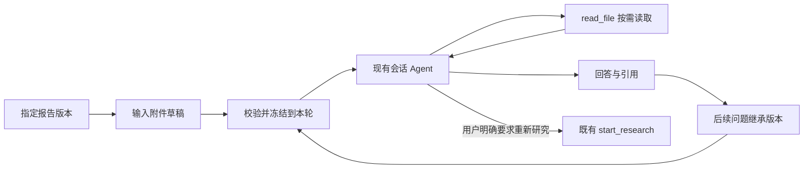

# 围绕报告继续对话（04-C2）

报告讨论属于普通会话。用户选择一份不可变报告，既有会话 Agent 按需读取正文、矩阵与证据，再回答当前问题。研究 Agent 的中间执行历史仍保留在独立任务中。

## 使用流程

1. 在任务页选择报告版本，点击“基于此报告提问”。优先进入来源会话；来源缺失、已删除或已归档时创建普通会话。
2. 输入框上方显示报告引用卡片，包含名称、讨论版本、摘要、打开入口和移除按钮。
3. 可以连续询问方法比较、实验条件、结论依据。后续消息继承引用，刷新后从持久快照恢复。
4. 新报告出现时只提示可切换。切换或移除属于下一条消息的附件草稿；发送成功后持久化生效。失败保留输入和选择。
5. 历史用户消息显示各自的报告版本链接。编辑原消息或重试沿用原绑定，同样文字但引用不同报告的问题不合并。

## 类型与职责

| 类型/位置 | 职责 |
| --- | --- |
| domain.ReportSelection | 消息输入：run_id、report_id，或 clear=true |
| domain.ReportContext | 服务端生成的标题、版本、摘要、矩阵 hash 与只读地址 |
| domain.ReportContextState | 在 ContextJSON 中分别保存请求选择和已解析引用 |
| app/report_context.go | 项目归属、Run 对应关系、继承与移除，生成当前轮的资料说明 |
| SQLite runtime | 复用 context_json；投影 Turn.report_context；同一幂等键改变选择返回冲突 |
| 共用 UI 快照 | 返回 Turn.report_context 和持久 Message.extra.report_context，Web 与未来 CLI 共用 |
| useReportContext / ReportContextCard | 输入草稿、载入错误、版本目录、切换和移除的展示 |

不增加数据库表、模型工具或 CLI 命令。应用规则不依赖 React 或浏览器 URL。

## 消息协议

```json
{
  "text": "哪些结论有原文依据？",
  "idempotency_key": "message-1",
  "report_context": {"run_id": "run-1", "report_id": "report-v1"}
}
```

- 省略 report_context 或传 null：继承当前会话上一条有效轮次的引用。
- `{"clear":true}`：移除，不能同时携带 ID。后续省略继续保持未引用状态。
- 显式选择必须同时给出 run_id/report_id；归属当前用户与项目，且报告确实属于该 Run。
- 客户端不提交标题、版本、正文或路径，服务端从真实报告补全。
- 输入选择单独参与幂等比较。后续项目、历史或当前引用变化，不改变旧消息重放的原版本；同键换选另一份报告返回 409。

## 运行与资料地址

新普通会话使用 single/multi-v9，独立研究继续 single-v8。v1–v8 的既有上下文、工具 schema 和检查点仍按原版本恢复。v9 修正普通会话“报告尚未开放”的过时提示。

会话 Graph 每轮只追加一次当前报告的元数据和读取指引；正文按需进入工具结果。系统提示不预装整篇报告，历史消息保持原来的边界，并用简短地址说明当时引用的版本。



| 地址 | 内容 |
| --- | --- |
| research://reports/REPORT_ID/report.md | 此版本的报告 Markdown |
| research://reports/REPORT_ID/matrix.json | 此报告冻结的矩阵行 |
| research://reports/REPORT_ID/references.json | 此报告冻结的证据引用 |
| research://documents/DOC_ID/blocks/BLOCK_ID.txt | 对应冻结原文块 |

矩阵与引用分页返回 report_id、run_id、report_revision、matrix_hash、revision 和 next；后续页继续使用绑定内容版本的地址。`research://runs/RUN_ID/matrix.json` 仍表示当前矩阵，不能替代历史报告的矩阵。

每条引用额外返回应用生成的 citation_url 和 source_path，分别打开真实引用与冻结原文；list_directory 可发现报告正文、矩阵与引用地址。

模型决定读哪些资料、如何解释、是否追问以及是否调用 start_research。代码校验引用的项目归属与版本；代码校验通过不代表推理语义正确。回答应区分报告结论、模型推断与未知，并链接真实原文。

## 验证与边界

后端专项覆盖持久继承、显式移除、服务重建、编辑/重试、旧版隔离、显式切换、跨项目拒绝、错误 Run、输入冲突和历史消息引用。single/multi 脚本模型均通过真实 Graph 和 read_file 读取资料索引、任务、报告目录、报告、证据快照与原文块，再保存带真实引用的回答，研究任务数量保持不变。

浏览器专项位于 `web/e2e/report-conversation.spec.ts`，覆盖来源会话、多轮追问、刷新、移除、无效引用阻止发送、来源删除、手机布局、新版提示、版本切换与网络失败保留草稿。新版界面使用受控资料目录响应模拟，真实版本生成与切换另由 SQLite 集成测试验证；其余主流程使用临时数据库中的真实接口。

离线模型只演示资料读取和引用，界面明确标注，不模拟语义研究能力。本批不调用真实收费模型；研究结论质量需另行抽查。五候选四分析的综合场景和整阶段故障恢复仍属于后续验收。

实际命令与结果见 [ACCEPTANCE.md](ACCEPTANCE.md)。实施计划见 [2026-10-26-report-conversation.md](../../docs/superpowers/plans/2026-10-26-report-conversation.md)。
